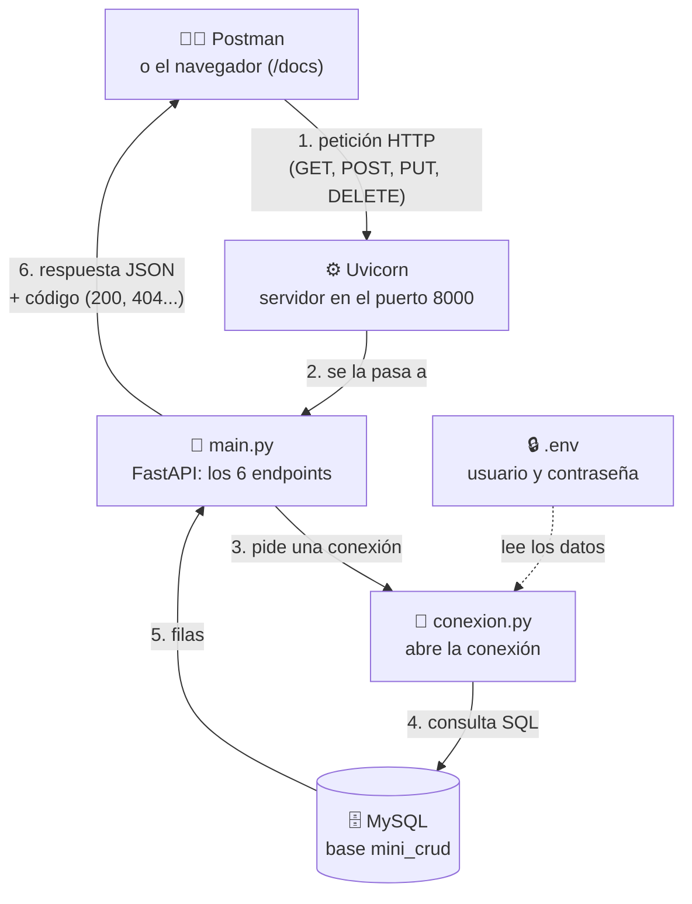
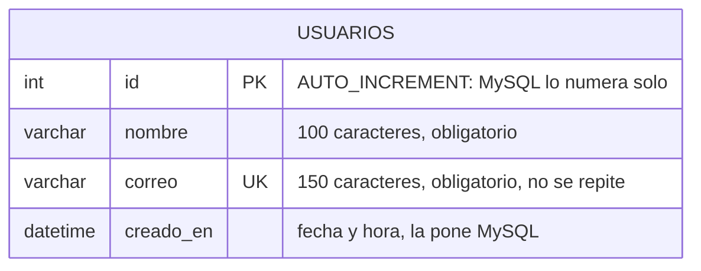
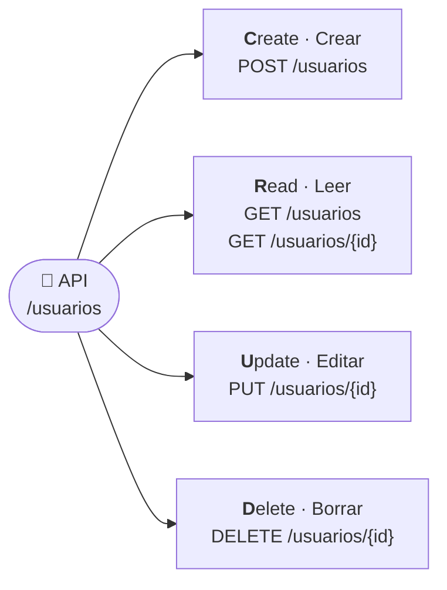
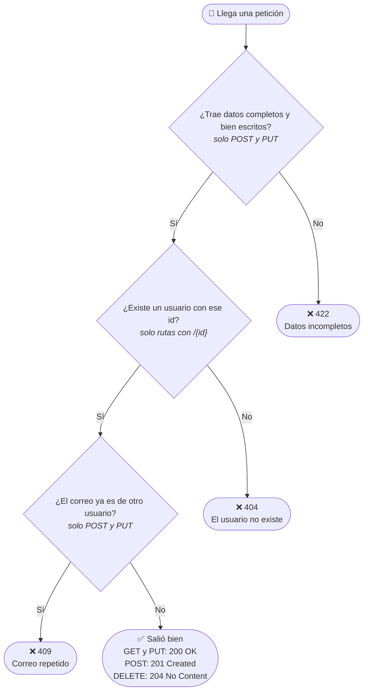
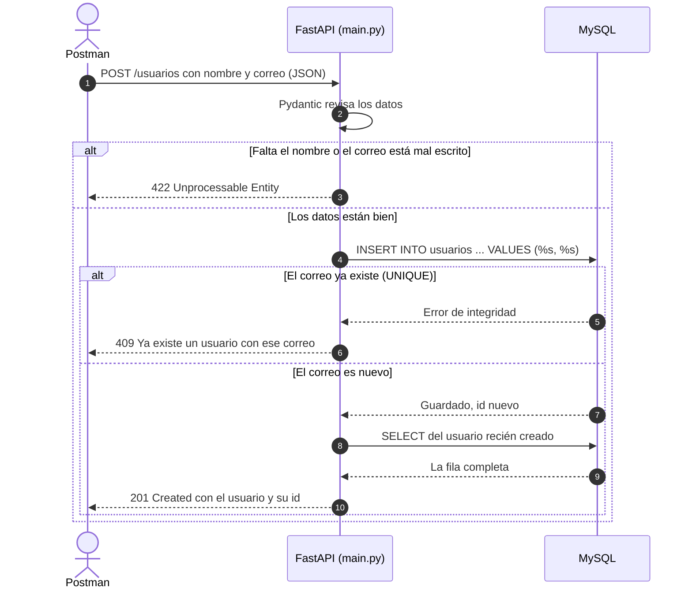
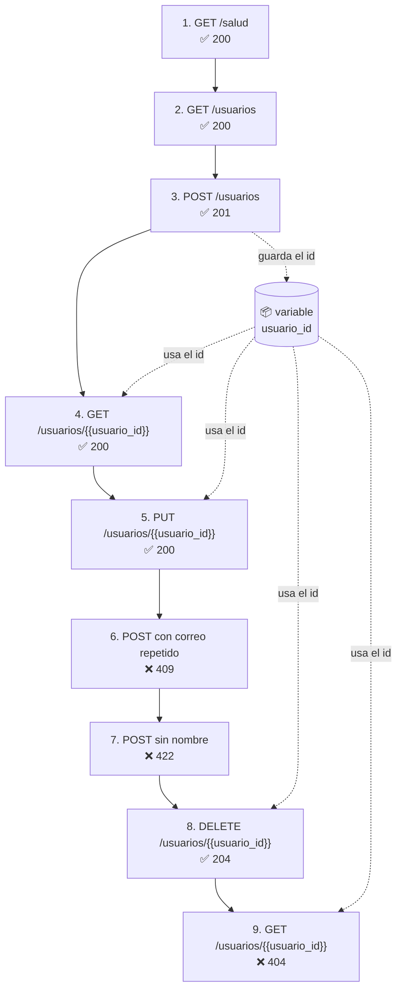
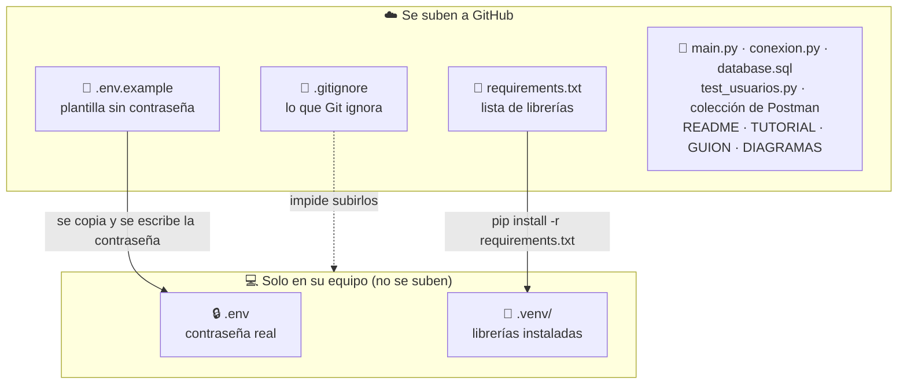

# Diagramas del Mini CRUD de usuarios

Diagramas sencillos para entender **cómo funciona** el proyecto. GitHub los dibuja solo (están escritos en **Mermaid**, un lenguaje de texto para hacer diagramas).

1. [Las piezas del proyecto](#1-las-piezas-del-proyecto)
2. [La tabla `usuarios`](#2-la-tabla-usuarios)
3. [Los endpoints y sus respuestas](#3-los-endpoints-y-sus-respuestas)
4. [El viaje de una petición: crear un usuario](#4-el-viaje-de-una-petición-crear-un-usuario)
5. [La colección de Postman](#5-la-colección-de-postman)
6. [Los archivos y GitHub](#6-los-archivos-y-github)

---

## 1. Las piezas del proyecto

Quién habla con quién cuando se envía una petición.

**Cómo leerlo:**

- **Postman** es el "cliente": el que pregunta.
- **Uvicorn** recibe la petición en el puerto 8000 y se la entrega a **FastAPI**.
- **FastAPI** (`main.py`) decide qué endpoint la atiende y revisa los datos.
- **conexion.py** se conecta a **MySQL** con los datos del **`.env`**.
- La respuesta vuelve a Postman en formato **JSON**, con un **código** que dice cómo salió.

---

## 2. La tabla `usuarios`

La única tabla de la base `mini_crud`.

| Marca | Significa |
|---|---|
| **PK** (Primary Key) | Identifica cada fila. No se repite. |
| **UK** (Unique Key) | No se repite: dos usuarios no pueden tener el mismo correo. Por eso existe el error **409**. |

---

## 3. Los endpoints y sus respuestas

Cada endpoint es **un método + una ruta**. Corresponden a las 4 letras de CRUD:

Además está `GET /salud`, que solo dice si el servidor está encendido.

**¿Cómo decide la API qué código responder?** Hace estas preguntas, en este orden:

| Endpoint | Posibles respuestas |
|---|---|
| `GET /salud` | 200 |
| `GET /usuarios` | 200 |
| `GET /usuarios/{id}` | 200, 404 |
| `POST /usuarios` | 201, 409, 422 |
| `PUT /usuarios/{id}` | 200, 404, 409, 422 |
| `DELETE /usuarios/{id}` | 204, 404 |

**Regla fácil para recordar los códigos:**

- **2xx** (200, 201, 204): salió bien.
- **4xx** (404, 409, 422): el error está en lo que se pidió (no existe, está repetido o faltan datos).

---

## 4. El viaje de una petición: crear un usuario

Qué pasa, paso a paso, al enviar `POST /usuarios`, y en qué momento aparece cada posible respuesta.

**Detalles importantes:**

- El **422** lo responde FastAPI **sin llegar a MySQL**: los datos se rechazan antes.
- El **409** lo provoca **MySQL**, porque el correo es `UNIQUE`; FastAPI lo traduce a un mensaje claro.
- Los `%s` del SQL son los lugares donde PyMySQL pone los datos **de forma segura** (así se evita la inyección SQL).

---

## 5. La colección de Postman

Las 9 peticiones van en orden. La petición 3 guarda el `id` del usuario nuevo en la variable `usuario_id`, y las peticiones 4, 5, 8 y 9 la usan.

- Los ❌ son **errores a propósito**: demuestran que la API responde bien cuando algo está mal. Sus pruebas también salen en verde.
- Al final, el usuario creado queda borrado: la base vuelve a tener los 3 usuarios de ejemplo.

---

## 6. Los archivos y GitHub

Qué archivos se suben a GitHub y cuáles se quedan solo en el equipo.

- **`.env`** tiene la contraseña: por seguridad **nunca** se sube. Se sube **`.env.example`**, que es la plantilla.
- **`.venv/`** se crea en cada equipo con `requirements.txt`.
- **`.gitignore`** es la lista de lo que Git debe ignorar.
